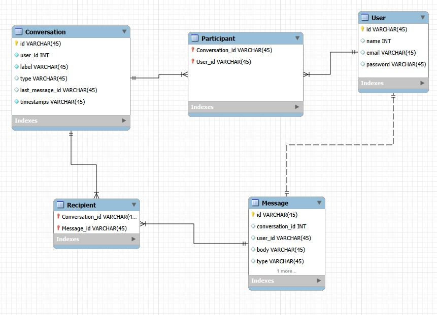

# Laravel Messager App
## I built a Web App about Message App, I used a Laravel & Vue.js.
### I used Axios Library to connect the Front-end (Vue) with Back-end (Laravel).

### I also used libraries like: Pusher.js, Laravel Echo, Laravel Mix, Apline.js, Bootstrap, Tailwind CSS, Moment.js & Carbon, UI Avatars.
### I connect to AWS + Redis.

----------------------------------------------------------

### **Structure:**
**Models:**  
1. Conversation  
2. Message  
3. User  
4. Participant(Pivot)  
5. Recipient(Pivot)  
 

**Front End Components By Vue.js:**  
1.	Messenger  
2.	ChatHeader  
3.	ChatContent  
4.	ChatFooter  
5.	ChatList  

----------------------------------------------------------
### **Setting:**  
*App:* NAME, ENV, KEY, DEBUG, URL  
*Database:* CONNECTION, HOST, PORT, DATABASE, USERNAME, PASSWORD  
*Redis:* HOST, PASSWORD, PORT  
*AWS:* ACCESS_KEY_ID, SECRET_ACCESS_KEY, REGION, BUCKET  
*Pusher:* ID, KEY, SECRET, CLUSTER  

----------------------------------------------------------

Best Regards
wahab, wahabkame@gmail.com

